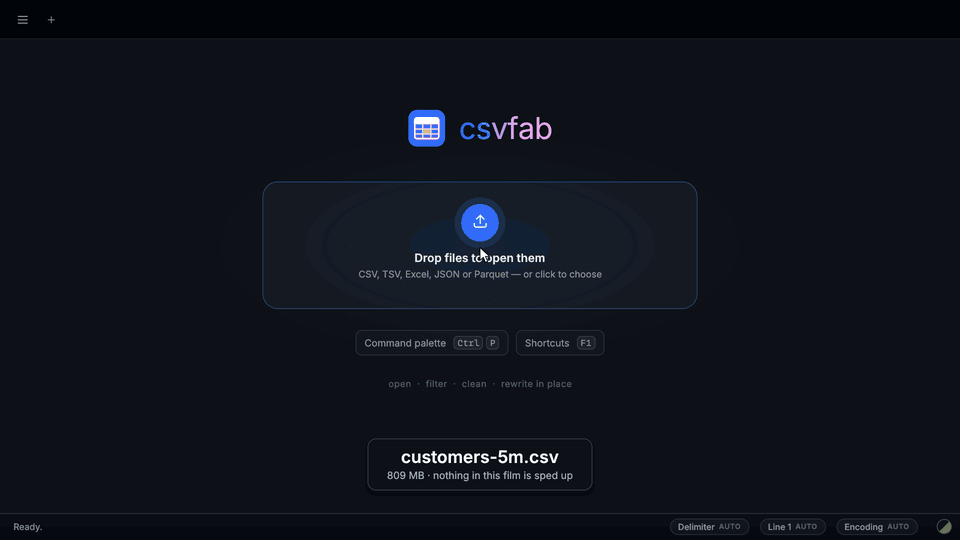
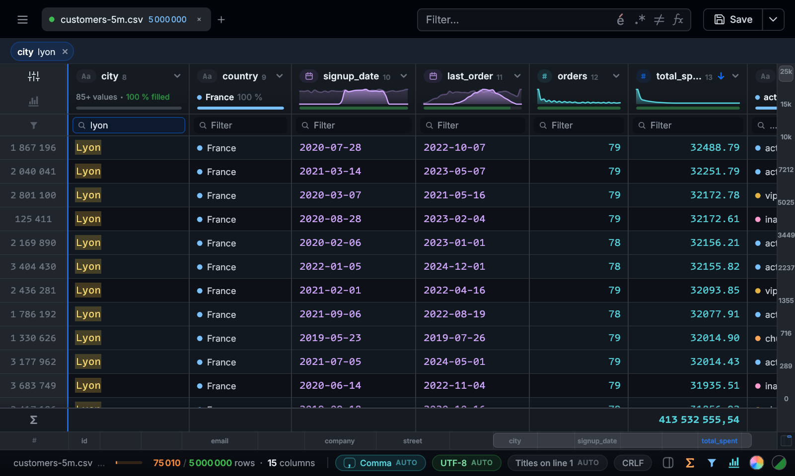

<p align="center"></p>

# csvfab

*Fabulously fast CSV editing.*

**The CSV editor for files spreadsheets can't open.** csvfab opens, filters and sorts 5 million rows in about a tenth of a second each, and **edits the file in place** — on Linux, macOS and Windows, as one native program with nothing else to install.

[](benchmark/csvfab-demo.mp4)



▶ **[Watch the 1-minute demo](benchmark/csvfab-demo.mp4)** — filmed in real time, nothing sped up.

## Speed

The same file on the same machine: 5,000,000 rows × 15 columns, 809 MB (771 MiB), a customer export generated by the benchmark.

| | csvfab 2.1.1 (2026-10-30) | VisiData 3.5 (2026-10-30) | Modern CSV 2.4.4 (2026-10-03) | Excel, LibreOffice Calc |
|---|---:|---:|---:|---|
| Open, every row known | **65 ms** | 12 s | 4.6 s | stop at 1,048,576 rows |
| Filter a column | **71 ms** | 5.4 s | Premium only | |
| Sort numbers | **117 ms** | 22 s | 53 s | |
| Sort text | **57 ms** | 10 s | 24 s | |
| Peak memory | **980 MB** (private: 193 MB) | 5.9 GB | 5.6 GB | |

The first rows are on screen after 44 ms. csvfab maps the file instead of copying it: its peak counts those pages, which the system can take back at any time, and the heap is the private figure.

At 1 million rows (153 MB), csvfab opens the file in 35 ms, filters it in 36 ms and sorts it in 28–45 ms:

- **30 to 82 times faster** than VisiData
- **144 to 208 times faster** than Modern CSV to sort (its 2026-10-03 times)

**How it was measured**: median of 3 fresh processes, the file in the OS cache, on an Intel Core Ultra X7 358H laptop (16 threads, 31 GB RAM), Linux, in use. csvfab and VisiData were measured on 2026-10-30, by `benchmark/run.py`. Modern CSV has no scripting interface: it is the free version, in edit mode, timed by hand on 2026-10-03 on the same machine (its read-only mode opens the file in 3.1 s but cannot sort), on an earlier version of the generated file.

[The method, every size, and published figures for other tools →](benchmark/README.md)

## Features

- **Open anything**: tabs, drag & drop, "Open with" from your file manager; delimiter (`;` `,` tab `|`), header line and encoding (UTF-8, Windows-1252, ISO-8859-1, ISO-8859-15, Mac Roman, UTF-16) detected, and changeable from the status bar. An Excel workbook or a JSON file is first written as a CSV beside it, then opened.
- **Find what matters**: global and per-column filters (accents ignored, regex, invert), or a filter written as a formula (`num({Amount}) > 1000 && contains({City}, "lyon")`); a column panel with a profile (type, distinct values, min / max / sum / average) and a filter by value; a profile of the whole file, every column on one line; sort by clicking a title (Shift+click to sort on several columns); group by one or more columns with counts, sums and averages into a new tab; go to a row by number (Ctrl+G); find without filtering (Ctrl+F, F3): every match highlighted in the rows shown, stepped through one by one; a scroll strip over the scrollbar with the initials, years or values of the sort column along it, marks for irregular, duplicate and changed rows, and the row under the pointer as you drag.
- **See every column at a glance**: under each title, a chart of what the column holds — a smooth curve of how numbers and dates spread, with their range and a gauge of how full the column is, and for text a ribbon of the most frequent values ending with the empty cells. Filter, and every chart shows where the rows left sit against the whole file; click a slice of a curve, a value or the empty part to filter on it, or drag across a curve to keep a range (from March to June, from 100 to 500 €).
- **Let it tell you what it noticed**: *Insights* reads the file and lists, as cards, what deserves a look — the key column, or the few values that come back in one meant to identify every row; a column that decides another (postal code → city) except on a few rows; values written otherwise than the rest of their column (`7501` among `75011`, an ISO date among `15/03/2024`, `DUPONT` among `Dupont`, `12.50` among `10,50`); numbers or dates far from all the others; rows that are exact copies; hidden arithmetic (`TTC = HT × 1,2`, `TTC = HT + TVA`) on every row or all but a few; empty and constant columns, stray spaces. A click shows the rows concerned, the faulty cell marked with what was expected.
- **Fill by example**: type the result you want in a cell or two of a column — `Dupont` beside `M. Jean DUPONT`, `jean.dupont@acme.fr` beside *Jean* and *Dupont*, `15/03/1984` beside `1984-03-15` — and the rest of the column appears in grey, read the same way from each row, with the rule spelled out; Tab fills it in (one undo), Escape forgets it.
- **Totals under every column**: a row held at the bottom of the grid sums the amounts of the rows shown, and a click on any column gives its average, median, smallest or largest value, earliest or latest date, filled, empty or distinct count — recomputed as you filter, on millions of rows, without slowing anything down. The filter row can be hidden, its filters still applying.
- **See every filter at work**: each filter in force — the search, a column's, the values hidden from its panel or a chart, duplicates or marks shown alone — is a chip in the toolbar, removed by its ×; the search options are symbols that light up.
- **Rich values**: a column of links or e-mail addresses (Ctrl+click opens or writes), of yes / no (checks), of colours (a swatch) or of JSON is recognised and drawn as such; rest the pointer on a value cut short to read it whole, JSON indented. Colour a numeric column by value, and freeze the columns up to any one of them.
- **Read the grid at a glance**: a column of few values (a status, a source, a city) shows them as pills in the colours of its chart; a sorted view draws a line between groups and keeps the current group's name under the header; the active row is tinted. Hovering a part of a column chart brightens the matching values and marks where they are along the scrollbar. Filtering, the rows slide to close the gaps.
- **Right-click everywhere**: a column title offers to split, merge, insert or delete the column, a row number its menu, a cell a menu to copy, paste, copy the row, fill by example, keep or hide the rows holding that value, open the row card or delete the row; a text field its own cut, copy, paste and, for a filter, clear.
- **Read one record**: the row card (Ctrl+I) shows the selected row as a form, every column with its editable value, and its raw line as it sits in the file — delimiters, quotes and invisible characters marked.
- **Debug a broken file**: *Why does this row look wrong?* examines the row's own bytes — expected and observed field counts, the probable cause (an unquoted delimiter, located by the column types it would realign; a line cut by an unquoted line break; a quote never closed; missing fields), the bytes around each anomaly in hex, UTF-8 lines in a Windows-1252 file, garbled accents, NUL and invisible characters, cells a spreadsheet would run as formulas — and proposes a repair, as an ordinary undoable edit.
- **Edit like a spreadsheet**: in-place and multi-line editing, range selection, copy & paste with Excel or Google Sheets, series fill (drag the corner or Ctrl+D), typing into many cells at once, find & replace with regex, bulk edits on filtered rows, mark or remove duplicates (exact, case-insensitive or slugified), delete hidden rows, split and merge columns, computed columns (formulas), look up values from another open file (like VLOOKUP), convert dates, numbers and phone numbers to one format, clean up the whole file (garbled accents like `é`, invisible characters, odd spaces, empty rows and columns), remove noise words (a list of words such as `SARL`, `Monsieur` or `et Fils` taken out of one column or of every column, whole words, case and accents ignored), fill empty cells from the value above, compare two versions of a file on a key column, anonymise a file for a demo (names swapped for others with the same initial, e-mails and phone numbers reshaped, postal codes keeping their department, dates shifted — the same value always giving the same fake), insert / move / rename / delete rows and columns — and **undo** (Ctrl+Z) all the way back to the last save, **redo** (Ctrl+Y) what you undid, with a review of every pending change against the file on disk before you save.
- **Validate a file against its rules**: create a schema from a file that is right — column types, required and unique columns, bounds, lengths, lists of allowed values, code formats suggested from the values' shapes, text checks (no invisible characters, no double spaces, no garbled accents, upper case or capitalised) — written beside it as `name.schema.json` ([Table Schema](https://specs.frictionlessdata.io/table-schema/), readable by other tools), then check any later file with it: missing or unexpected columns, and each kind of error counted with examples, a click showing its rows with the faulty cells marked. `customers_2026-10-04.csv` finds `customers.schema.json` by itself.
- **Pivot table**: rows × columns of counts, sums, averages, minimums, maximums or distinct values, dates grouped by month, quarter or year, with totals and a colour scale — computed live on millions of rows (a million in under a second), and a click on any number shows the rows behind it. Copy it into a spreadsheet or open it as a new tab.
- **Split and combine files**: one file per value of a column (per agency, per month…) in a new folder, every row copied byte for byte; or several files with different delimiters, encodings and column orders combined into one, columns matched by their titles.
- **Large files**: the file stays as its own bytes in memory, rows are decoded only when shown or searched — a 2 GB CSV of 20 million rows opens in seconds without freezing the window, and a save copies the untouched lines as they are.
- **Write safely**: opening and saving a file without changing it gives back the same bytes, valid or not — and an edit changes only the bytes of its own line (tested on a corpus of broken files: quoted newlines, mixed line endings, BOMs, UTF-16 with or without BOM and with broken surrogates, mixed encodings, unclosed quotes, NUL bytes, random bytes). Save rewrites the file in its own delimiter, line endings and encoding, keeps a timestamped `.bak` before the first overwrite, notices when another program changed the file meanwhile, and flags irregular rows. Save as another name, delimiter or encoding, or as a formatted Excel workbook (typed numbers and dates, bold frozen header, filters).

## Install

| | |
|---|---|
| **Arch Linux** | the script below — the AUR package `csvfab` will follow once the AUR reopens registrations |
| **macOS** (Homebrew) | `brew install --cask fabiochelly/csvfab/csvfab` — csvfab.app in /Applications, offered in the Finder's "Open with" for CSV files (`brew install fabiochelly/csvfab/csvfab` for the command line alone) |
| **Windows** (winget) | `winget install FabioChelly.csvfab` |
| **Linux / macOS** (script) | `curl -fsSL https://raw.githubusercontent.com/fabiochelly/csvfab/main/install.sh \| sh` |
| **Windows** (script) | `irm https://raw.githubusercontent.com/fabiochelly/csvfab/main/install.ps1 \| iex` |

Nothing else is needed: csvfab is one program (Linux x86-64 with glibc 2.35 or newer, macOS 11 or newer on Apple silicon or Intel, Windows 10 or 11 x64). The scripts install per user, without admin rights, and replace a 1.x installation; `install.sh --uninstall` / `install.ps1 -Uninstall` remove it. On macOS, `install.sh` also builds `csvfab.app` in `~/Applications` and offers to make it the default app for CSV files (with [duti](https://github.com/moretension/duti); otherwise: select a `.csv`, File › Get Info › Open with › csvfab › Change All…).

**From the sources** (any platform Rust supports): `git clone https://github.com/fabiochelly/csvfab && ./csvfab/install.sh` (or `install.ps1`) builds it with [Rust](https://rustup.rs) and installs it; `cargo build --release -p csvfab` alone gives `target/release/csvfab`. How the code is laid out: [docs/app.md](docs/app.md).

## Use

```sh
csvfab                  # open the window
csvfab data.csv more.tsv
csvfab export.xlsx      # converted to export.csv beside it, which is what opens
csvfab data.parquet     # the same for Parquet
csvfab server.log app.py  # not a table: opened as raw text, one line per row, coloured
csvfab data.sqlite        # a table of a SQLite database, as a CSV beside it
```

A file that is not a table (a log, code, configuration) opens in *Raw text* mode: one line per row, every space kept, syntax colours from the theme's VS Code palette, Ln / Col in the status bar, saved back byte for byte. The delimiter menu of the status bar switches between raw text and a table. A JSON file asks whether to flatten its records into a CSV or open it as text. On a raw text file, *Follow* in the status bar shows new lines as they are written, as `tail -f`.

Files opened while the window is already there land in it as new tabs. A double-click on a column's resize handle fits it to its content.

| Shortcut | |
|---|---|
| Ctrl+P | command palette — every action, setting, tab, recent file and column, searched as you type |
| Ctrl+O / Ctrl+S | open / save |
| Ctrl+W / Ctrl+Q | close the tab / quit |
| F1 | every keyboard shortcut |
| Ctrl+Z / Ctrl+Y | undo / redo |
| Ctrl+F, F3 / Shift+F3 | find in the rows shown without filtering them — every match highlighted, next / previous match |
| Ctrl+C / Ctrl+V | copy / paste a range (Excel format) |
| Ctrl+A, arrows, Shift+arrows | select |
| Home / End, Ctrl+Home / Ctrl+End | first / last cell of the row, of the file |
| Enter, F2, double-click, or just type | edit — Enter selects the text, F2 and double-click put the caret at its end; Enter fills every selected cell, Ctrl+Enter a series, Shift+Enter a new line |
| Ctrl+D | fill the series down |
| Ctrl+E | fill by example — after a result or two typed in a column; Tab takes the values offered, Escape drops them |
| Ctrl+I | row card — the selected row as a form, and its raw line |
| Ctrl+G | go to a row by its number |
| Alt+← / Alt+→ | switch tab |

## How it works

csvfab is written in Rust: `engine/` reads, filters, sorts, edits and writes the tables, and `app/` is the window ([egui](https://github.com/emilk/egui)). The file is mapped into memory, not copied: its records are found in parallel, each row decoded only when shown or searched, and a save writes the untouched lines back byte for byte, atomically, keeping a `.bak` first. Nothing is sent anywhere: the only network use is a font you choose to install from the font menu.

Settings, recent files and crash recovery live in `~/.local/state/csvfab` (Linux), `~/Library/Application Support/csvfab` (macOS) or `%LOCALAPPDATA%\csvfab` (Windows).

## License

[MIT](LICENSE) © Fabio Chelly
